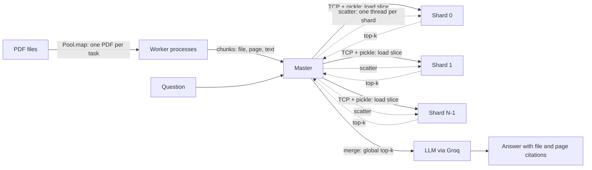

# ParaRAG

**Ask questions about hundreds of PDFs, answered with page citations, using parallel ingestion and a sharded, fault-tolerant search cluster built from plain Python processes, threads and TCP sockets.**

ParaRAG is a Retrieval-Augmented Generation (RAG) system whose point is the *concurrency design underneath it*: which tool (processes, threads, sockets) fits which bottleneck, what it gains, what it costs, and what happens when a node fails. It was built for the *Systèmes Distribués et Parallèles* course at ISAMM (University of Manouba), using only the techniques of that course: `multiprocessing`, `threading`, `queue`, TCP `socket` and `pickle`.

---

## The problem

A RAG demo works on three PDFs. On a real collection, three things break:

1. **Reading PDFs is slow.** Text extraction is CPU-bound work done one file after another.
2. **One process holds the whole index.** Memory and search time grow with the corpus.
3. **One crash takes everything down.** There is a single point of failure.

## The solution

| Bottleneck | Answer | Python tool |
|---|---|---|
| CPU-bound PDF parsing | Spread PDFs over worker **processes** (the GIL makes threads useless for this) | `multiprocessing.Pool` |
| One big index | Split it into **shards**: independent server processes, each owning a slice | `Process` + TCP sockets + `pickle` |
| Searching all shards quickly | Ask every shard **at the same time** (one thread each), then merge the top results | `threading` + `queue.Queue` |
| A node dies | Timeouts, a **degraded mode** that still answers, and **revive** that restarts and reloads the shard | `terminate()`, `is_alive()`, exception handling |
| Turning passages into an answer | An LLM (Groq) writes the answer from the retrieved passages and cites them | HTTP API call (I/O-bound) |

## Architecture



**Ingestion (once).** Each worker process extracts the text of its PDFs and cuts it into chunks of 100 words, sliding by 80 words (so a sentence split at a boundary is not lost). Every chunk keeps its file name and page number. The master then computes how rare each word is across the whole corpus and sends each shard its slice of chunks, together with that shared word-rarity table.

**Each question.** The master sends the question to all shards simultaneously. Each shard scores its own chunks with TF-IDF and returns its top results. The master merges them into the global top results and hands them to the LLM, which answers using only those passages.

**Why the results are correct.** The global top-k is always contained in the union of each shard's top-k. Word rarity is computed *globally* by the master and shared with all shards, so scores from different shards are comparable. A test checks that the distributed answer is identical to a single index over the whole corpus.

## Features

- Parallel PDF ingestion with a process pool
- Sharded index served over TCP, one process per shard
- Scatter-gather search with one thread per shard and a thread-safe queue
- Fault tolerance: dead or slow shards never crash a query; the answer is returned in degraded mode with a warning
- `/kill` and `/revive` commands to demonstrate failure and recovery live
- Damaged PDFs are repaired when possible (PyMuPDF) and skipped otherwise, without stopping the run
- Table-of-contents pages are filtered out so they do not pollute results
- Optional LLM answers with `[file p.N]` citations; without an API key it prints the retrieved passages
- Test suite and a benchmark suite

## Quick start

**Requirements:** Python 3.10+ (developed on 3.12).

```bash
git clone https://github.com/Yusuf-BR/ParaRAG
cd pararag

python -m venv .venv
# Windows PowerShell:  .\.venv\Scripts\Activate.ps1
# Linux / macOS:       source .venv/bin/activate

pip install -r requirements.txt
```

Put your PDFs in a folder (for example `my_pdfs/`), then run:

```bash
python main.py my_pdfs 4
```

The `4` is used both as the number of ingestion worker processes and the number of shards (default: 4). Shards listen on local ports `5000` to `5000 + n - 1`.

### Enabling LLM answers (optional)

1. Create a Groq API key at <https://console.groq.com>.
2. Copy `.env.example` to `.env` and fill in the key:

```
GROQ_API_KEY=your_key_here
# GROQ_MODEL=openai/gpt-oss-120b
```

Without a key, ParaRAG still works and prints the retrieved passages. `GROQ_MODEL` is optional; check Groq's model list if the default is ever retired.

### Commands

| Input | Effect |
|---|---|
| any text | Search the corpus and, if a key is set, generate an answer |
| `/kill <i>` | Terminate shard `i` (simulate a crash) |
| `/revive` | Restart dead shards and reload their slice |
| `/quit` | Stop everything |

### Example session (illustrative)

```
12 PDFs -> 940 chunks in 1.31s (4 processes)
4 shards ready. Ask a question, or: /kill <i>  /revive  /quit
question> what is the GIL?
  1.44  course.pdf p.19  ...
  1.39  course.pdf p.5   ...

The GIL (Global Interpreter Lock) is a mutex that lets only one thread run
Python code at a time ... [course.pdf p.5]
question> /kill 1
shard killed
question> what is the GIL?
!! degraded mode: 1 shard(s) unreachable, part of the corpus is missing
  ...
question> /revive
dead shards restarted and reloaded
```

## Tests

```bash
python -m unittest test_pararag
```

Five tests check that:

1. the distributed top-k is identical to a single index over the whole corpus;
2. a killed shard degrades the answer without crashing and is reported;
3. after `revive`, answers are identical to the full index again;
4. parallel ingestion equals serial ingestion and finds a planted fact at the right file and page;
5. a truncated PDF is repaired and an unreadable one is skipped without stopping the run.

## Benchmarks

```bash
python bench.py
```

The benchmark has three parts. Results below come from one run on Windows with 16 logical cores and Python 3.12. They are **single measurements on one machine; expect different numbers on yours.**

**1. Why processes (CPU-bound jobs, pure Python):**

| Mode | Time | Speedup |
|---|---|---|
| serial | 2.73 s | 1.00x |
| threads | 3.22 s | 0.85x |
| processes | 1.56 s | 1.75x |

Threads do not speed up CPU-bound Python code because of the GIL; processes do.

**2. PDF ingestion (120 PDFs x 100 pages):**

| Workers | Time | Speedup | Efficiency |
|---|---|---|---|
| 1 (serial) | 7.69 s | 1.00x | 1.00 |
| 2 | 4.88 s | 1.58x | 0.79 |
| 4 | 3.13 s | 2.46x | 0.61 |
| 8 | 2.62 s | 2.93x | 0.37 |
| 16 | 2.96 s | 2.59x | 0.16 |

Efficiency is speedup divided by the number of workers. Speedup grows, flattens, then drops: starting processes and sending results back has a cost. On a much lighter corpus (120 PDFs x 20 pages) the best speedup was only about 1.3x, because the whole job was shorter than the process start-up cost. Parallel ingestion pays off when per-file work is large.

**3. Search latency (60,000 chunks, 30 queries):**

| Shards | Latency per query | Speedup |
|---|---|---|
| 1 | 75.8 ms | 1.00x |
| 2 | 71.3 ms | 1.06x |
| 4 | 63.9 ms | 1.19x |
| 8 | 43.6 ms | 1.74x |

This part is noisy: in other runs the same test gave 2.8x to 3.7x at 4 to 8 shards. Each query pays fixed costs (connections, threads, merging) that do not shrink with more shards, so returns diminish.

The benchmark corpus is synthetic (four distinct generated PDFs, copied to reach 120 files), which is enough to measure scaling but says nothing about retrieval quality.

## Project structure

```
pararag/
├── main.py            # CLI: ingest, start the cluster, interactive questions
├── ingest.py          # PDF -> chunks, parallel with a process pool
├── master.py          # Cluster: starts shards, scatter-gather search, kill/revive
├── shard.py           # TCP shard server + TF-IDF index
├── net.py             # Message framing over TCP (length header + pickle)
├── generate.py        # LLM answer generation through Groq
├── make_corpus.py     # Synthetic PDFs for tests and benchmarks
├── test_pararag.py    # Test suite
├── bench.py           # Benchmarks
├── requirements.txt
└── .env.example
```

## Course concepts used

| Concept | Where |
|---|---|
| The GIL, I/O-bound vs CPU-bound | Choice of processes for ingestion, threads for the network scatter; GIL demo in `bench.py` |
| `multiprocessing.Pool`, `Process`, `terminate`, `is_alive`, `daemon`, `if __name__ == "__main__"` | `ingest.py`, `master.py`, `main.py` |
| `threading.Thread`, `start`, `join`; `Queue` | Scatter-gather in `master.py` |
| `pickle` serialization | Messages between master and shards |
| TCP sockets: `bind`, `listen`, `accept`, `connect`, `send`/`recv` loops, `SO_REUSEADDR` | `shard.py`, `net.py`, `master.py` |
| Client/server and 1-to-N messaging, independent memories, fault tolerance | Overall architecture |

Not used on purpose: locks, semaphores and barriers (shards share no memory, they only exchange messages), and UDP (every reply must arrive complete and in order).

## Design decisions

- **Processes for ingestion, threads for search.** Parsing is CPU-bound, so the GIL blocks threads. Waiting on sockets is I/O-bound, so threads are enough. PyMuPDF also does not support being called from several threads.
- **Messages, not shared memory.** Shards are separate processes, so no locks are needed.
- **TCP, not UDP.** A lost or reordered reply would silently corrupt a search.
- **Length-prefixed messages.** TCP is a byte stream without message boundaries, so each message starts with its size.
- **Global word statistics.** Computed once by the master so that shard scores can be merged.
- **TF-IDF, not embeddings.** Keeps the code small and dependency-free, and keeps each shard independent.

## Limitations

- The cluster is processes on one machine (`127.0.0.1`), not several computers. Running across machines would mean changing the addresses.
- Retrieval is keyword-based: it matches words, not meaning, so questions phrased differently from the document can rank poorly.
- Scanned PDFs without a text layer produce no chunks (no OCR).
- A shard that hangs but stays alive is not detected as dead by `revive`.
- Shards are iterative servers: one request at a time each.
- The LLM can still make mistakes. Citations let you check its answer against the source pages.
- Shards use `pickle` and therefore only listen on localhost; never expose them to an untrusted network.

## Future work

Semantic retrieval with embeddings, persistent connections between master and shards, OCR for scanned documents, a multi-machine deployment, and multithreaded shard servers.

